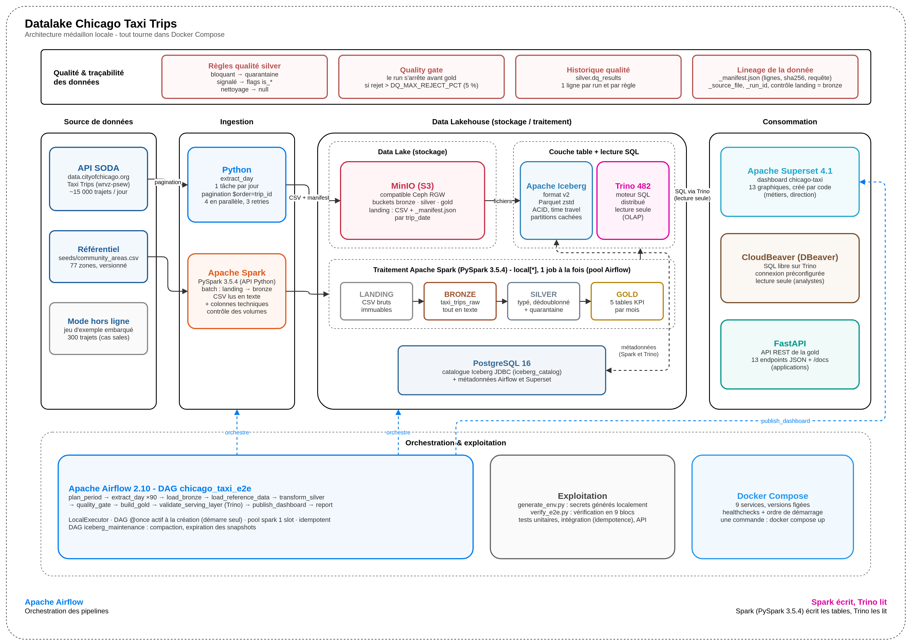

# Datalake Chicago Taxi Trips - pipeline médaillon de bout en bout

Pipeline data engineering **ingestion → nettoyage → agrégats BI** sur le dataset public
*Chicago Taxi Trips*, construit sur une stack datalake open source :

**MinIO (S3) · Apache Iceberg · Spark (PySpark) · Trino · Airflow · Superset**, avec un client
SQL web (DBeaver) et une API REST (FastAPI) sur les indicateurs, le tout dans Docker Compose.

```bash
python scripts/generate_env.py    # 1re fois uniquement : génère .env avec des secrets aléatoires
docker compose up -d --build
```

Aucune autre action n'est nécessaire : la plateforme s'initialise, le DAG Airflow démarre seul,
télécharge les données, construit les couches bronze → silver → gold, vérifie la couche
d'exposition dans Trino et publie les dashboards. Il ne reste qu'à ouvrir
**http://localhost:8088/superset/dashboard/chicago-taxi/** (activité) et
**http://localhost:8088/superset/dashboard/chicago-taxi-quality/** (qualité des données), avec
les identifiants affichés par `generate_env.py` et stockés dans `.env`.

> Pourquoi une commande de plus que `docker compose up` ? Aucun mot de passe n'est versionné ni
> partagé entre installations : chaque poste génère ses propres secrets, comme en production.

> **Première installation sur un nouveau poste ?** Suivre les [prérequis](#1-prérequis) et le
> [lancement pas à pas](#2-lancement-pas-à-pas), puis vérifier toute la chaîne avec
> `python scripts/verify_e2e.py --with-tests` ([vérification](#vérifier-linstallation)).

---

## Sommaire

1. [Prérequis](#1-prérequis)
2. [Lancement pas à pas](#2-lancement-pas-à-pas)
3. [Architecture](#3-architecture)
4. [Le pipeline](#4-le-pipeline)
5. [Modèle de données](#5-modèle-de-données)
6. [Qualité des données](#6-qualité-des-données)
7. [Exposition : Trino, Superset, DBeaver et API](#7-exposition--trino-superset-dbeaver-et-api)
8. [Jeu de données : période, volume, téléchargement](#8-jeu-de-données--période-volume-téléchargement)
9. [Choix de chaque brique et arbitrages](#9-choix-de-chaque-brique-et-arbitrages)
10. [Passage en production (Ceph)](#10-passage-en-production-ceph)
11. [Tests et qualité du code](#11-tests-et-qualité-du-code)
12. [Structure du repo](#12-structure-du-repo)
13. [Limites et pistes d'évolution](#13-limites-et-pistes-dévolution)

---

## 1. Prérequis

| | Minimum |
|---|---|
| Docker | Docker Engine 24+ / Docker Desktop, avec **Compose v2** (`docker compose version`) |
| Mémoire allouée à Docker | **8 Go** (10 Go recommandés) : Spark 3 Go + Trino 2 Go + Airflow + Superset |
| Ports libres | 4040, 8000, 8080, 8081, 8088, 8978, 9000, 9001 (modifiables dans `.env` : `*_HOST_PORT`) |
| Disque | **~15 Go libres** sur le disque de Docker (images ~8 Go, cache de build, données ~2 Go). Si C: est juste : Docker Desktop → Settings → Resources → Advanced → *Disk image location* vers un autre disque |
| Réseau | accès à `data.cityofchicago.org` (API SODA), Docker Hub, Maven Central, PyPI au build |

Outils locaux : Docker et Python 3 (bibliothèque standard uniquement, pour générer `.env`) ;
`make` est optionnel.
Sous Windows/macOS, augmenter la mémoire dans *Docker Desktop → Settings → Resources*.

## 2. Lancement pas à pas

```bash
git clone https://github.com/addi-kamal/chicago-taxi-datalake.git
cd chicago-taxi-datalake

# 1. générer .env : secrets aléatoires, le reste repris de .env.example
python scripts/generate_env.py          # ou : make env

# (optionnel) ajuster .env : période, jeton SODA, ports...

# 2. construire et démarrer
docker compose up -d --build            # ou : make up
```

Ensuite :

| Étape | Où regarder | Durée indicative |
|---|---|---|
| Build des images (1ʳᵉ fois) | terminal | 5-10 min |
| Initialisation (`init` : bases, buckets, tables Iceberg, Airflow) | `docker compose logs -f init` | ~1 min |
| Pipeline `chicago_taxi_e2e` (démarre seul) | Airflow http://localhost:8081, vue *Grid* | ~10 min pour la semaine par défaut, 30-45 min pour le trimestre * |
| Résultat | dashboards http://localhost:8088/superset/dashboard/chicago-taxi/ et `.../chicago-taxi-quality/` | - |

\* La durée est dominée par l'API publique SODA (10 à 120 s par jour téléchargé, 4 jours en
parallèle). Un [jeton applicatif SODA gratuit](https://data.cityofchicago.org/profile/edit/developer_settings)
dans `SODA_APP_TOKEN` limite le throttling. Les étapes Spark prennent quelques minutes.

### URLs et accès

| Service | URL | Identifiants |
|---|---|---|
| **Dashboard Activité** (Superset) | http://localhost:8088/superset/dashboard/chicago-taxi/ | `SUPERSET_ADMIN_USER` / `SUPERSET_ADMIN_PASSWORD` |
| **Dashboard Qualité des données** (Superset) | http://localhost:8088/superset/dashboard/chicago-taxi-quality/ | idem |
| Airflow | http://localhost:8081 | `AIRFLOW_ADMIN_USER` / `AIRFLOW_ADMIN_PASSWORD` |
| Trino (UI + JDBC) | http://localhost:8080 | utilisateur libre, sans mot de passe |
| Console MinIO | http://localhost:9001 | `S3_ACCESS_KEY` / `S3_SECRET_KEY` |
| **DBeaver** (CloudBeaver, SQL sur Trino) | http://localhost:8978 | `DBEAVER_ADMIN_USER` / `DBEAVER_ADMIN_PASSWORD` |
| **API gold** (FastAPI, doc Swagger) | http://localhost:8000/docs | - (lecture seule) |
| Spark UI (job en cours) | http://localhost:4040 | - |

Les valeurs se trouvent dans `.env` ; `generate_env.py` les affiche à la génération.

### Période : une semaine par défaut, le trimestre à la demande

Par défaut, le pipeline traite **une semaine** (du 2023-01-01 au 2023-01-07, ~84 000 trajets) :
le premier lancement valide toute la chaîne en une dizaine de minutes. Le **trimestre complet**
(T1 2023, ~1,45 million de trajets) prend **30 à 45 minutes**, essentiellement pour télécharger
les 90 jours depuis l'API publique.

Lancer le trimestre sur la stack déjà démarrée (les jours déjà téléchargés sont sautés, les
tables sont mises à jour sans doublon) :

```bash
make run START=2023-01-01 END=2023-04-01
# sans make :
docker compose exec airflow-scheduler airflow dags trigger chicago_taxi_e2e \
  --conf '{"start_date": "2023-01-01", "end_date": "2023-04-01"}'
```

Ou en faire la période par défaut, en repartant de zéro : `PIPELINE_END_DATE=2023-04-01` dans
`.env`, puis `docker compose down -v` et `docker compose up -d`.

Sans réseau vers l'API, un jeu d'exemple embarqué (300 trajets dont des cas « sales ») :
`PIPELINE_SOURCE=sample` et `PIPELINE_END_DATE=2023-01-04` dans `.env`.

### Commandes utiles

| `make` | Équivalent sans make | Rôle |
|---|---|---|
| `make up` | `docker compose up -d --build` | démarrer (le pipeline se lance seul) |
| `make run` | `docker compose exec airflow-scheduler airflow dags trigger chicago_taxi_e2e` | relancer le pipeline |
| `make run START=2023-02-01 END=2023-03-01` | `... dags trigger chicago_taxi_e2e --conf '{"start_date":"2023-02-01","end_date":"2023-03-01"}'` | autre période |
| `make status` | `docker compose exec airflow-scheduler airflow dags list-runs -d chicago_taxi_e2e` | état des runs |
| `make smoke` | `docker compose exec airflow-scheduler python /opt/airflow/project/scripts/smoke_test.py` | contrôle des tables + aperçu des KPIs via Trino |
| `make verify` | `python scripts/verify_e2e.py --with-tests` | vérification complète de l'installation |
| `make test` | voir [§11](#11-tests-et-qualité-du-code) | tests unitaires, intégration et API dans les conteneurs |
| `make trino-cli` | `docker compose exec trino trino --catalog iceberg` | console SQL |
| `make down` / `make clean` | `docker compose down` / `docker compose down -v` | arrêter / tout effacer |

### Vérifier l'installation

```bash
python scripts/verify_e2e.py --with-tests     # ou : make verify
```

Le script (bibliothèque standard Python uniquement) attend la fin du pipeline si nécessaire, puis
contrôle toute la chaîne :

| Bloc | Contrôle |
|---|---|
| 1. Prérequis | `.env` complet, Docker joignable |
| 2. Services | les 8 services *healthy*, `init` terminé avec succès |
| 3. Interfaces | Airflow, Trino, Superset, MinIO, DBeaver et l'API répondent depuis le poste |
| 4. Pipeline | aucun DAG en erreur, dernier run en **success** |
| 5. Données | tables bronze, silver, gold remplies ; bronze ≥ silver + quarantaine ; 77 zones |
| 6. Dashboards | connexion à Superset ; dashboard Activité (11 graphiques) et dashboard Qualité des données (10 graphiques) |
| 7. DBeaver | connexion, connexion Trino préconfigurée, requête SQL réelle sur la gold |
| 8. API | endpoints en 200 ; trajets de `/v1/kpis` = lignes de `silver.taxi_trips` |
| 9. Tests | tests unitaires, d'intégration (dont idempotence) et de l'API, dans les conteneurs |

Résultat attendu : `RÉSULTAT : tout est opérationnel ✔` (code de sortie 0, utilisable en CI).
Variantes : sans `--with-tests` (~30 s), ou `--no-wait` (état instantané).

**Valeurs de référence** : identiques sur tout poste tant que la source n'est pas corrigée par
la ville de Chicago (chaque jour téléchargé est tracé dans son `_manifest.json`).

| Contrôle | Semaine (défaut) | Trimestre (T1 2023) |
|---|---|---|
| `bronze.taxi_trips_raw` | 83 667 lignes | 1 446 439 lignes |
| `silver.taxi_trips` | 83 667 lignes | 1 446 430 lignes |
| `silver.taxi_trips_rejected` | 0 ligne | 9 lignes (`end_before_start`) |
| `gold.daily_revenue` | 7 lignes | 90 lignes |
| Trajets / CA / ticket moyen / pourboire | 83,7 k / 2,21 M$ / 26,40 $ / 10,9 % | 1,45 M / 36,9 M$ / 25,54 $ / 12,4 % |

### Dépannage

| Symptôme | Cause | Solution |
|---|---|---|
| `required variable ... is missing a value: lancer scripts/generate_env.py` | `.env` absent ou incomplet | `python scripts/generate_env.py` (sur un `.env` existant : ajoute les clés manquantes sans toucher aux secrets) |
| Build : `no space left on device`, `Read-only file system`, `Input/output error` | disque plein | libérer de l'espace ou déplacer le stockage Docker, `docker system prune -a`, relancer le build |
| `cannot import name …` dans un conteneur après un disque plein | couches d'image corrompues | `docker compose down`, `docker rmi` des images concernées, `docker image prune -af`, rebuild |
| `init` en échec : `password authentication failed` | `.env` régénéré alors que les volumes gardent les anciens mots de passe | `docker compose down -v` puis `docker compose up -d --build` |
| Tâches `extract_day` en *up_for_retry* | API publique lente ou saturée | rien à faire (retries automatiques) ; option : jeton gratuit `SODA_APP_TOKEN` |
| `java.lang.OutOfMemoryError` dans une tâche Spark | moins de 8 Go alloués à Docker | augmenter la mémoire, ou réduire la période / `SPARK_DRIVER_MEMORY` |
| `port is already allocated` | port déjà utilisé | changer `AIRFLOW_HOST_PORT`, `TRINO_HOST_PORT`, `API_HOST_PORT`… dans `.env` |
| Dashboard vide | page ouverte pendant la publication ou cache froid | recharger (F5) |
| DBeaver : connexion Trino absente | créée uniquement au **premier** démarrage de CloudBeaver | `docker compose rm -sf dbeaver`, `docker volume rm chicago-taxi-datalake_dbeaver-workspace`, `docker compose up -d dbeaver` |
| API : `503` | Trino indisponible ou pipeline pas encore passé | attendre `trino` *healthy* et la fin du DAG ; `GET /health/ready` |
| Git Bash : `/opt/...` transformé en `C:/Program Files/Git/opt/...` | conversion de chemins | utiliser PowerShell, ou préfixer par `MSYS_NO_PATHCONV=1` |
| Un service reste `unhealthy` | voir ses logs | `docker compose logs <service>` |

## 3. Architecture



Source modifiable du schéma : [assets/architecture.drawio](assets/architecture.drawio) (à ouvrir
avec draw.io / diagrams.net).

**Principe : Spark écrit, Trino lit.** Les deux moteurs partagent le même catalogue Iceberg
(`iceberg`) et le même stockage : une table écrite par Spark est immédiatement requêtable dans
Trino sous le même nom, `iceberg.gold.daily_revenue`, comme en production.

| Service | Image (version figée) | Rôle |
|---|---|---|
| `postgres` | `postgres:16.9` | métadonnées Airflow, catalogue Iceberg, Superset |
| `minio` | `pgsty/minio:RELEASE.2026-06-18T00-00-00Z` | stockage S3, un bucket par couche |
| `init` | image pipeline (one-shot) | rôles/bases, buckets, tables Iceberg, migrations Airflow, pool |
| `airflow-webserver`, `airflow-scheduler` | build `apache/airflow:2.10.5-python3.11` + JDK 17 + PySpark 3.5.4 + Iceberg 1.8.1 | orchestration et exécution Spark `local[*]` |
| `trino` | `trinodb/trino:482` | moteur SQL / OLAP |
| `superset` | build `apache/superset:4.1.2` + driver Trino | dashboards activité et qualité des données |
| `dbeaver` | `dbeaver/cloudbeaver:26.2.3` | client SQL web : connexion Trino préconfigurée (lecture seule) |
| `api` | `chicago-taxi/api` (build sur `python:3.11.11-slim`) | API REST FastAPI de lecture de la gold, via Trino |

Layout du stockage (un bucket par couche, mêmes noms dans tous les environnements : les
métadonnées Iceberg contiennent des chemins absolus `s3://bucket/...`) :

```
s3://bronze/landing/chicago_taxi/trip_date=2023-01-01/part-00000.csv     # brut, immuable
s3://bronze/landing/chicago_taxi/trip_date=2023-01-01/_manifest.json     # lignes, pages, sha256, requête
s3://bronze/warehouse/bronze/taxi_trips_raw/{data,metadata}/              # Iceberg
s3://silver/warehouse/silver/{taxi_trips,taxi_trips_rejected,dq_results,dim_community_area}/
s3://gold/warehouse/gold/{daily_revenue,trip_duration_stats,top_pickup_areas,payment_mix,company_performance}/
```

Organisation du code : `docker/<service>/` décrit **comment construire l'environnement**
(Dockerfiles, configuration) ; le code qui tourne dedans est dans `src/taxi_pipeline/` + `dags/`
(image `docker/airflow`) et dans `api/` (image `docker/api`).

### Où tourne Spark ?

Il n'y a **pas de conteneur Spark dédié** : c'est un choix assumé pour le POC. Spark tourne **dans
le conteneur `airflow-scheduler`**, en mode `local[*]` : driver et exécuteurs vivent dans une même
JVM, qui utilise tous les cœurs alloués au conteneur.

```
conteneur airflow-scheduler
 └─ Airflow (LocalExecutor)
     └─ tâche load_bronze / transform_silver / build_gold
         └─ PySpark 3.5.4 → JVM Spark (Java 17, local[*])
             ├─ jars Iceberg 1.8.1 + S3 + JDBC PostgreSQL
             └─ écrit les tables Iceberg dans MinIO, enregistrées dans le catalogue JDBC
```

- Chaque tâche Spark **démarre sa propre SparkSession puis l'arrête** : aucune JVM ne reste en
  mémoire entre deux étapes.
- Le pool Airflow `spark` (1 slot) garantit **un seul job Spark à la fois**.
- **Spark UI** : http://localhost:4040 pendant l'exécution d'un job Spark.
- Toute la configuration passe par une factory unique,
  [src/taxi_pipeline/spark.py](src/taxi_pipeline/spark.py).

**Pourquoi pas de cluster Spark (master + workers) en local ?**

| Critère | `local[*]` (retenu) | Cluster standalone dans Compose |
|---|---|---|
| Volume traité (~1,3 M lignes, ~500 Mo) | quelques minutes par étape | même temps de calcul : le gain du parallélisme distribué n'apparaît qu'à des volumes bien supérieurs |
| RAM (poste avec ~8 Go pour Docker) | un seul driver (3 Go), libéré après chaque tâche | +2 à 3 Go permanents (master + worker + JVM des exécuteurs) |
| Exploitation | 0 service supplémentaire | 2 conteneurs de plus, avec versions Python/PySpark/jars à garder identiques sur driver et workers |
| Démarrage pour l'utilisateur | inchangé : `docker compose up` | plus long, plus de points de panne |

**Passage à l'échelle** : le code ne dépend pas du mode d'exécution. Il suffit de changer
`SPARK_MASTER` (`spark://spark-master:7077` pour un cluster standalone, `k8s://…` pour Kubernetes)
et d'exécuter la même image sur les workers. Aucune ligne de code métier ne change. C'est ainsi
que le pipeline se déploierait sur un cluster Spark de production.

## 4. Le pipeline

DAG Airflow **`chicago_taxi_e2e`** ([dags/chicago_taxi_e2e.py](dags/chicago_taxi_e2e.py)),
planifié `@once` et **actif à la création** : il se lance automatiquement au premier démarrage.

```
plan_period ─► extract_day[jour 1..N] ─► load_bronze ─► load_reference_data ─► transform_silver
            (mappé, 4 en parallèle,                                                   │
             3 retries + backoff)                                                     ▼
report ◄─ publish_dashboard ◄─ validate_serving_layer ◄─ build_gold ◄─────────── quality_gate
          (API Superset)        (Trino relit silver/gold)                (échec si rejet > 5 %)
```

| Tâche | Moteur | Ce qu'elle fait |
|---|---|---|
| `plan_period` | Python | valide la période (paramètres du DAG) et liste les jours |
| `extract_day` | Python | télécharge un jour depuis SODA (`$order=trip_id`, pages de 50 000), contrôle l'en-tête, écrit le CSV puis le manifest ; jour déjà présent → sauté |
| `load_bronze` | Spark | CSV → `bronze.taxi_trips_raw` ; vérifie que le nombre de lignes chargées = lignes téléchargées |
| `load_reference_data` | Spark | `seeds/community_areas.csv` → `silver.dim_community_area` |
| `transform_silver` | Spark | typage, nettoyage, dédoublonnage, règles qualité → silver + quarantaine + `dq_results` |
| `quality_gate` | Python | affiche les résultats qualité ; **fait échouer le run** si le taux de rejet dépasse `DQ_MAX_REJECT_PCT` |
| `build_gold` | Spark | recalcule les 5 tables gold sur les mois complets touchés |
| `validate_serving_layer` | Trino | Trino relit silver (même volume que Spark) et chaque table gold (non vide) |
| `publish_dashboard` | API Superset | crée/rafraîchit connexion, datasets, graphiques et les 2 dashboards |
| `report` | Python | récapitulatif des volumes et URL des dashboards |

Principes :

- **DAGs minces** : toute la logique est dans `src/taxi_pipeline` (indépendant d'Airflow) ; les
  tâches appellent `taxi_pipeline.jobs` et échangent des types simples (jamais de DataFrame).
- **Une SparkSession par tâche Spark**, arrêtée en fin de tâche ; pool Airflow `spark` à 1 slot.
- **Idempotence** à chaque étape (manifests, `overwritePartitions`, `overwrite` par filtre, commits
  Iceberg atomiques) : relancer la même période donne les mêmes tables.
- Deuxième DAG **`iceberg_maintenance`** (hebdomadaire, en pause par défaut) : compaction,
  `rewrite_manifests`, expiration des snapshots, fichiers orphelins.
- Le même code tourne hors Airflow : `python -m taxi_pipeline.jobs all --start 2023-01-01 --end 2023-01-08`.

## 5. Modèle de données

| Couche | Table | Grain / contenu | Partition |
|---|---|---|---|
| bronze | `iceberg.bronze.taxi_trips_raw` | 23 colonnes source en `string`, non modifiées + `_source_file`, `_ingested_at`, `_run_id` | `trip_date` |
| silver | `iceberg.silver.taxi_trips` | 1 ligne par trajet valide, typé (timestamps `TIMESTAMP_NTZ`, montants `decimal(10,2)`), flags `is_duration_outlier`, `is_distance_outlier`, `is_amount_inconsistent` | `days(trip_start_ts)` |
| silver | `iceberg.silver.taxi_trips_rejected` | valeurs brutes + `reject_reason` | `trip_date` |
| silver | `iceberg.silver.dq_results` | 1 ligne par (exécution, règle) | - |
| silver | `iceberg.silver.dim_community_area` | 77 zones : id, nom, *side* | - |
| gold | `iceberg.gold.daily_revenue` | jour : trajets, CA, fare, tips, ticket moyen, taux de pourboire, taxis actifs | `trip_month` |
| gold | `iceberg.gold.trip_duration_stats` | jour × heure : durée moyenne/médiane/p90, distance, vitesse (hors outliers) | `trip_month` |
| gold | `iceberg.gold.top_pickup_areas` | mois × zone : trajets, CA, part, rang | `trip_month` |
| gold | `iceberg.gold.payment_mix` | jour × moyen de paiement : trajets, CA, parts | `trip_month` |
| gold | `iceberg.gold.company_performance` | mois × compagnie : trajets, taxis, CA, ticket, pourboires, rang | `trip_month` |

Toutes les tables : Iceberg **format v2**, Parquet **zstd**, DDL explicite dans
[src/taxi_pipeline/tables.py](src/taxi_pipeline/tables.py).

**Définition des KPIs**

| KPI | Définition |
|---|---|
| Périmètre | trajets de `silver.taxi_trips` (toutes les règles bloquantes passées) |
| `total_revenue` (CA) | Σ `trip_total` = tarif + pourboires + péages + suppléments |
| `avg_ticket` | moyenne de `trip_total` ; sur une période : CA / trajets |
| `tip_rate` | Σ `tips` / Σ `fare`. Les pourboires en espèces ne sont pas déclarés dans la source : taux sous-estimé pour le cash |
| `active_taxis` | nombre de `taxi_id` distincts |
| Durées | `trip_seconds` / 60 (la durée fiable : les timestamps source sont arrondis au quart d'heure) ; médiane et p90 par `percentile_approx` |
| `avg_speed_mph` | Σ miles / Σ heures (vitesse moyenne pondérée, pas une moyenne de vitesses) |
| `share_of_*` | part dans le total du jour ou du mois (fraction, somme = 1) |
| `area_rank`, `revenue_rank` | rang dans le mois (1 = premier) |

Les KPIs financiers incluent tous les trajets valides (le CA est encaissé quoi qu'il arrive) ; les
KPIs de durée, distance et vitesse excluent les outliers signalés. Les trajets sans zone de prise
en charge sont absents de `top_pickup_areas` mais présents partout ailleurs. Les tables gold sont
recalculées par **mois complets** : un agrégat mensuel n'est juste que si tout le mois est
recalculé.

> **Fuseau horaire** : les timestamps source sont en heure locale de Chicago, sans fuseau. Ils sont
> stockés en `timestamp` sans fuseau (`TIMESTAMP_NTZ` dans Spark, `timestamp(6)` dans Trino) et
> jamais convertis en UTC. Ils sont **arrondis au quart d'heure** dans la source : la durée fiable
> est `trip_seconds`.

## 6. Qualité des données

| Niveau | Règles | Effet |
|---|---|---|
| **Bloquant** | `trip_id` absent ; début absent, illisible ou hors période ; fin < début ; montant négatif | ligne en quarantaine (`taxi_trips_rejected`) |
| **Signalé** | durée ≤ 0 ou > 24 h ; distance < 0 ou > 500 mi ou vitesse > 100 mph ; total ≠ somme des composantes (± 1 $) | ligne conservée, flag `is_*` |
| **Nettoyage** | community area hors 1-77 ; coordonnées hors de Chicago | valeur mise à null |
| Info | doublons de `trip_id` | garde l'ingestion la plus récente |

Chaque exécution historise ses métriques dans `silver.dq_results` (visibles dans le dashboard Qualité des données) et
la tâche `quality_gate` arrête le pipeline avant gold si le taux de rejet bloquant dépasse
`DQ_MAX_REJECT_PCT` (5 %). Sur données réelles (10/01/2023, 14 255 trajets) : 0 rejet, 1,8 %
d'outliers de durée.

**Pourquoi trois niveaux** : une ligne fausse ne doit pas polluer les KPI, mais on ne la supprime
pas (la quarantaine permet de l'analyser) ; une ligne suspecte n'est pas forcément fausse (le flag
laisse l'analyste décider) ; une information invalide ne doit pas faire perdre tout le trajet. Le
gate protège le dashboard : un taux de rejet qui explose signale presque toujours un changement
côté source, et mieux vaut le dashboard d'hier, correct, que celui d'aujourd'hui, faux.

## 7. Exposition : Trino, Superset, DBeaver et API

### Dashboards Superset

Deux dashboards publiés automatiquement en fin de pipeline (**dashboard as code** :
[src/taxi_pipeline/bi/superset.py](src/taxi_pipeline/bi/superset.py)), un par public. Chacun
renvoie vers l'autre depuis son en-tête.

**« Chicago Taxi - Activité »** (`chicago-taxi`, métiers et direction), lu dans la **gold** :

- **KPIs** : trajets, chiffre d'affaires, ticket moyen, taux de pourboire ;
- **Tendance** : CA quotidien, trajets quotidiens par moyen de paiement, part des moyens de paiement ;
- **Géographie et temporalité** : top 15 des zones de prise en charge, heatmap d'affluence jour de
  semaine × heure, durée moyenne et p90 selon l'heure ;
- **Acteurs** : tableau des compagnies (volume, CA, taxis actifs, pourboires).

**« Chicago Taxi - Qualité des données »** (`chicago-taxi-quality`, équipe data), lu dans
**silver** (`dq_results`, quarantaine, flags) :

- **KPIs** : lignes ingérées (bronze), trajets valides (silver), lignes en quarantaine, taux de
  rejet du dernier run (comparé au seuil du quality gate) ;
- **Volumétrie par couche** et **lignes en échec par règle**, colorées par niveau (bloquant,
  signalé, nettoyage, info) ;
- **Lignes rejetées par jour et par motif** : un pic signale un problème côté source ce jour-là ;
- **Part des trajets signalés par jour** (durée aberrante, distance aberrante, montant
  incohérent) : une dérive se voit avant de fausser les KPIs ;
- **Détail des contrôles du dernier run** et **historique des exécutions**, pour suivre la qualité
  dans le temps.

Pourquoi deux dashboards : les métiers veulent des chiffres, l'équipe data veut savoir si elle
peut leur faire confiance. Les séparer garde le dashboard métier lisible, et donne à la qualité un
espace complet plutôt qu'une section en bas de page.

Superset interroge **Trino** : tout outil BI de l'équipe (Power BI, Metabase…) peut se brancher sur
la même source avec le même SQL.

### SQL direct dans Trino

```sql
-- docker compose exec trino trino --catalog iceberg
SELECT trip_month, community_area_name, trips, total_revenue
FROM iceberg.gold.top_pickup_areas
WHERE area_rank <= 5
ORDER BY trip_month, area_rank;
```

Une requête par KPI, plus des exemples de métadonnées Iceberg (snapshots, partitions, time
travel) : [sql/trino/sample_queries.sql](sql/trino/sample_queries.sql).

### Client SQL : DBeaver (CloudBeaver)

Pour explorer les tables sans ligne de commande, **http://localhost:8978** donne accès à
CloudBeaver, l'édition web de DBeaver. La connexion **« Trino - Datalake (iceberg) »** est
préconfigurée (dossier *Datalake*, lecture seule) : déplier `iceberg`, puis `bronze`, `silver` ou
`gold`, ou ouvrir l'éditeur SQL (bouton *SQL*) et coller les requêtes de `sample_queries.sql`.
Identifiants : `DBEAVER_ADMIN_USER` / `DBEAVER_ADMIN_PASSWORD` dans `.env`.

DBeaver desktop fonctionne aussi : nouvelle connexion **Trino**, hôte `localhost`, port `8080`,
base `iceberg`, utilisateur libre, sans mot de passe.

### API REST de la gold (FastAPI)

Pour les applications qui consomment les indicateurs sans écrire de SQL, l'API expose la gold en
JSON : **http://localhost:8000/docs** (documentation interactive).

```bash
curl "http://localhost:8000/v1/kpis?start=2023-02-01&end=2023-03-01"
curl "http://localhost:8000/v1/areas/top?month=2023-02&limit=5"
curl "http://localhost:8000/v1/companies?sort=tip_rate&min_trips=1000"
```

Conventions : `start` inclus, `end` exclu (`AAAA-MM-JJ`) ; mois au format `AAAA-MM` (défaut : dernier
mois disponible) ; ratios en fraction (0.124 = 12,4 %) ; montants en dollars US.

| Endpoint | Table | Paramètres | Usage |
|---|---|---|---|
| `GET /health`, `GET /health/ready` | - | - | le processus répond / Trino répond aussi (503 sinon) |
| `GET /v1/metadata` | `daily_revenue` | - | période couverte, mois disponibles, fraîcheur (dernier commit Iceberg) |
| `GET /v1/kpis` | `daily_revenue` | `start`, `end` | trajets, CA, ticket moyen, taux de pourboire |
| `GET /v1/revenue/daily`, `/v1/revenue/monthly` | `daily_revenue` | `start`, `end` | séries de CA |
| `GET /v1/durations/by-hour` | `trip_duration_stats` | `start`, `end`, `day_of_week` | profil horaire : durée, distance, vitesse |
| `GET /v1/durations/daily` | `trip_duration_stats` | `day` | heure par heure d'un jour, avec médiane et p90 |
| `GET /v1/areas/top`, `/v1/areas/{id}` | `top_pickup_areas` | `month`, `limit` / `id` | classement des zones, historique d'une zone |
| `GET /v1/payments/mix` | `payment_mix` | `start`, `end` | part des trajets et du CA par moyen de paiement |
| `GET /v1/companies` | `company_performance` | `month`, `sort`, `limit`, `min_trips` | classement des compagnies |
| `GET /v1/quality/latest` | `silver.dq_results` | - | règles qualité du dernier run |

Choix de conception :

- **Lecture via Trino** : mêmes tables, même moteur que le dashboard, donc mêmes chiffres
  (vérifié par `verify_e2e.py`) ; l'API ne connaît ni MinIO ni le catalogue.
- **Seulement la gold** : c'est le contrat stable pour les consommateurs ; le SQL libre sur silver
  passe par DBeaver.
- **Ratios recalculés à partir des sommes** sur une période (jamais de moyenne de moyennes
  quotidiennes) ; moyennes horaires **pondérées par le nombre de trajets** ; médiane et p90
  exposés **uniquement jour par jour**, car une médiane ne s'agrège pas.
- **`min_trips`** : trié par ratio, une compagnie de 70 trajets passerait devant une flotte de
  35 000.
- **Sécurité des requêtes** : valeurs passées en paramètres SQL (`?`), tri par liste blanche,
  validation (dates, mois, bornes) avant toute requête → 422 sans solliciter Trino.
- **Codes HTTP** : 503 si Trino est indisponible ou les tables absentes (réessayer plus tard),
  422 entrée invalide, 404 zone inconnue. `/health` (liveness) est séparé de `/health/ready`
  (readiness) : un redémarrage de Trino ne fait pas redémarrer l'API.
- **Utilisateur Trino `api`** : ses requêtes sont identifiables dans l'UI Trino.
- Limites assumées en local : pas d'authentification, de cache ni de limitation de débit (à
  ajouter avant toute exposition : clé d'API ou OAuth2, cache invalidé à chaque snapshot Iceberg,
  rate limiting).

## 8. Jeu de données : période, volume, téléchargement

| | |
|---|---|
| Source | City of Chicago - *Taxi Trips (2013-2023)*, dataset SODA `wrvz-psew`, endpoint `https://data.cityofchicago.org/resource/wrvz-psew.csv` |
| Période | par défaut **une semaine** (`2023-01-01` inclus au `2023-01-08` exclu) ; période cible **T1 2023** (`2023-01-01` au `2023-04-01` exclu), lancée à la demande ([voir plus haut](#période--une-semaine-par-défaut-le-trimestre-à-la-demande)). Variables `PIPELINE_START_DATE` / `PIPELINE_END_DATE` |
| Volume | ~14 000 à 15 000 trajets par jour (14 255 le 10/01/2023, 15 054 le 11/01/2023), soit **environ 1,45 million de lignes** et ~500 Mo de CSV pour le trimestre. Le volume exact de chaque jour est consigné dans son `_manifest.json` et contrôlé jusqu'à bronze |
| Filtre | `trip_start_timestamp >= 'J T00:00:00' AND trip_start_timestamp < 'J+1 T00:00:00'` |
| Pagination | `$order=trip_id` (ordre stable), `$limit=50000`, `$offset` incrémenté jusqu'à une page incomplète |
| Colonnes | `$select` explicite des 23 colonnes, en-tête contrôlé à chaque page |

Le téléchargement est fait par le DAG, mais le **même code** est utilisable seul pour reproduire
l'extraction :

```bash
# volume attendu, sans téléchargement
python scripts/download_taxi_data.py --start 2023-01-01 --end 2023-04-01 --count-only

# vers un dossier local
python scripts/download_taxi_data.py --start 2023-01-01 --end 2023-04-01 --local-dir data

# vers le datalake (MinIO), depuis la stack
docker compose exec airflow-scheduler \
  python /opt/airflow/project/scripts/download_taxi_data.py --start 2023-01-01 --end 2023-04-01
```

## 9. Choix de chaque brique et arbitrages

### Les briques

| Brique | Rôle | Pourquoi ce choix | Alternatives écartées |
|---|---|---|---|
| **Docker Compose** | toute la stack sur un poste | une commande, versions figées, reproductible ; rien à installer hors Docker et Python | Kubernetes local (kind, minikube) : trop lourd pour un POC mono-poste |
| **MinIO** (S3) | stockage objet, un bucket par couche | API S3 standard : le code (path-style, checksums `when_required`, aucun outil propre à MinIO) tourne à l'identique sur **Ceph RGW** ; les images MinIO officielles n'étant plus publiées, fork `pgsty/minio` figé | système de fichiers local (non représentatif de la prod), HDFS (lourd, en déclin) |
| **Apache Iceberg v2** (Parquet zstd) | format de table | transactions ACID sur des fichiers, partitions cachées (`days(trip_start_ts)`), évolution de schéma, time travel, maintenance ; lu et écrit par Spark comme par Trino | Delta Lake (support Trino moins complet), Parquet nu (pas de transactions : une relance interrompue peut laisser des doublons) |
| **Catalogue JDBC sur PostgreSQL** | registre des tables Iceberg, partagé Spark/Trino | aucun service supplémentaire (Postgres est déjà là pour Airflow et Superset) ; isolé dans la configuration, remplaçable par le catalogue de prod (REST, Hive) | Hive Metastore (un service Java de plus), catalogue REST (Nessie, Polaris : un service de plus pour un seul utilisateur) |
| **PostgreSQL 16** | métadonnées Airflow, Superset, catalogue Iceberg | une instance, trois bases logiques et trois comptes séparés | une instance par usage : plus de RAM sans bénéfice en local |
| **Spark 3.5 (PySpark)** `local[*]` | ingestion bronze, transformations silver, agrégats gold | standard du traitement distribué, intégration Iceberg native ; en `local[*]` dans les tâches Airflow, ~1,4 M lignes se traitent en minutes sans cluster ni 2-3 Go de RAM permanents ; `SPARK_MASTER` suffit pour passer sur un cluster | cluster standalone dans Compose (même temps de calcul à ce volume, plus de RAM et de points de panne), pandas/DuckDB (rapides ici, mais ne passent pas à l'échelle) |
| **Airflow 2.10** (LocalExecutor, TaskFlow) | orchestration | standard du marché ; DAG `@once` actif à la création (le pipeline démarre seul), mapping dynamique (une tâche par jour, relançable seule), retries, pool Spark à 1 slot ; 2.10 plutôt que 3.x : image Docker éprouvée, migration documentée | Prefect, Dagster (le code métier n'importe pas Airflow : un portage ne toucherait que `dags/`), cron (ni reprise, ni dépendances, ni UI) |
| **Trino 482** | moteur SQL de lecture (OLAP) | **Spark écrit, Trino lit** : requêtes interactives rapides sur Iceberg, SQL standard, point d'accès unique pour Superset, DBeaver et l'API | Spark Thrift Server (latence, moins adapté à l'interactif), lecture directe des fichiers par chaque outil (pas de point de contrôle unique) |
| **Superset 4.1** | dashboard métier | open source, connecteur Trino natif ; dashboard créé **par code** via l'API REST (versionné, zéro clic) | Metabase (moins pilotable par API), Power BI (licence, hors poste) : tous peuvent se brancher sur Trino |
| **CloudBeaver** (DBeaver web) | SQL libre pour analystes et data engineers | client SQL de référence, sans installation ; connexion Trino préconfigurée en lecture seule | CLI Trino seule (moins accessible), DBeaver desktop (installation sur chaque poste, mais fonctionne aussi) |
| **FastAPI** | API REST de lecture de la gold | validation des paramètres et documentation OpenAPI générées depuis le code, léger ; lit via Trino | Flask (validation et doc à écrire à la main), exposer Trino directement (pas de contrat stable pour les applications) |

### Les principes

| Sujet | Choix | Pourquoi |
|---|---|---|
| Architecture médaillon | landing → bronze → silver → gold | chaque couche a un contrat : brut immuable (preuve de la source), propre et contrôlé, métier ; un bug en silver se corrige en retraitant bronze, sans rappeler l'API |
| Bronze en `string` | aucune interprétation à l'ingestion | une valeur inattendue ne fait pas échouer le chargement ; le typage est une décision métier, prise en silver |
| Idempotence | manifests, `overwritePartitions`, overwrite par filtre, commits Iceberg atomiques | relancer la même période donne les mêmes tables, sans doublon : les relances deviennent sans danger |
| Traçabilité | manifest (lignes, sha256, requête), `_source_file`, `_run_id`, contrôle landing = bronze | chaque ligne remonte à son fichier et à son exécution ; aucune perte silencieuse |
| Code | fonctions pures (`transform.py`, `quality.py`, `aggregates.py`) séparées des entrées/sorties ; DAGs sans logique | logique testable sur un petit DataFrame, sans S3 ni catalogue ; orchestrateur remplaçable |
| Configuration | `pydantic-settings`, défauts non sensibles dans Compose, secrets générés dans `.env` | aucun secret versionné ; Compose refuse de démarrer si un secret manque ; même code en local et en prod |
| Versions | toutes figées (images, jars vérifiés SHA-1, contraintes pip Airflow et API) | builds reproductibles, aucun téléchargement au runtime |

## 10. Passage en production (Ceph)

1. Créer sur Ceph RGW un **utilisateur dédié** avec accès aux buckets `bronze`, `silver`, `gold`
   (mêmes noms qu'en local).
2. Basculer la configuration (`.env` ou secrets de l'orchestrateur) : `S3_ENDPOINT` (RGW),
   `S3_ACCESS_KEY`/`S3_SECRET_KEY`, `S3_REGION`, `S3_USE_SSL=true`, et le certificat de l'AC
   interne dans le truststore JVM de l'image si nécessaire.
3. Catalogue : pointer `ICEBERG_CATALOG_*` vers le catalogue de prod, ou adapter le type de
   catalogue dans `spark.py` et `iceberg.properties` (REST/Hive) ; enregistrer le catalogue dans
   le Trino de prod.
4. Spark : `SPARK_MASTER` vers le cluster de prod (standalone ou Kubernetes), avec la même image.
5. Airflow : CeleryExecutor/KubernetesExecutor, connexions et secrets via le backend de secrets.
6. Reprise des données POC si besoin : `rclone`/`mc mirror` des buckets ; les métadonnées Iceberg
   restent valides car les noms de buckets sont identiques.
7. Valider avec `scripts/smoke_test.py` pointé sur le Trino de prod (`TRINO_HOST`, `TRINO_PORT`).

## 11. Tests et qualité du code

| Niveau | Contenu | Commande |
|---|---|---|
| Unitaires | extraction SODA (pagination, en-tête, manifest, reprise), config/DDL, transformations silver et règles qualité sur un jeu d'exemple avec cas sales (doublons, dates inversées, montants négatifs, zones invalides...), agrégats gold (réconciliation avec silver, parts, rangs), mise en page des 2 dashboards, chargement des DAGs | `make test-unit` |
| Intégration | Spark écrit / Trino lit la même table ; **idempotence** : 2 exécutions complètes du pipeline donnent les mêmes compteurs dans toutes les tables ; timestamps sans fuseau dans Trino ; historique qualité | `make test-integration` |
| API | contrat HTTP, validation des entrées, paramètres SQL (Trino remplacé par une fausse base) | `make test-api` |
| Statique | `ruff` (lint + format), `mypy --strict` | `make lint` (après `make dev-install`) |

Les tests d'intégration utilisent des namespaces dédiés (`it_bronze`, `it_silver`, `it_gold`) et
une landing dédiée : ils ne touchent pas aux données du pipeline principal et nettoient leurs
tables en fin d'exécution.

Le jeu d'exemple est généré de façon déterministe par
[scripts/generate_sample_fixture.py](scripts/generate_sample_fixture.py) : 300 lignes dont
280 trajets valides, 3 doublons, 8 rejets bloquants et 9 lignes à nettoyer ou à signaler.

## 12. Structure du repo

```
.
├── docker-compose.yml          # toute la stack ; valeurs par défaut intégrées
├── .env.example                # modèle de .env (secrets générés par scripts/generate_env.py)
├── Makefile                    # raccourcis d'exploitation
├── pyproject.toml              # dépendances figées, ruff, mypy, pytest
├── dags/
│   ├── chicago_taxi_e2e.py     # pipeline de bout en bout (auto-démarré)
│   └── iceberg_maintenance.py  # compaction / snapshots (hebdomadaire)
├── src/taxi_pipeline/
│   ├── config.py · storage.py · spark.py · schemas.py · tables.py
│   ├── extract/                # SODA paginé -> landing (+ mode hors ligne)
│   ├── bronze/ · silver/ · gold/   # transformations pures + I/O séparées
│   ├── serving/                # contrôles Trino
│   ├── bi/superset.py          # dashboard as code
│   ├── maintenance/ · infra/   # maintenance Iceberg, initialisation plateforme
│   └── jobs.py                 # façade orchestrateur-agnostique (+ CLI)
├── docker/
│   ├── airflow/                # image Airflow + JDK 17 + PySpark + jars
│   ├── superset/               # image Superset + driver Trino, config, bootstrap
│   ├── api/                    # image de l'API (python slim, non-root)
│   ├── dbeaver/                # connexion Trino préconfigurée pour CloudBeaver
│   └── trino/catalog/          # iceberg.properties
├── api/                        # API REST FastAPI de la gold (app/, tests/, dépendances)
├── assets/                     # schéma d'architecture (.drawio modifiable + export .png)
├── seeds/community_areas.csv   # référentiel versionné (source documentée)
├── sql/trino/sample_queries.sql
├── scripts/                    # generate_env.py, verify_e2e.py, download_taxi_data.py, smoke_test.py, generate_sample_fixture.py
└── tests/
    ├── fixtures/sample_trips.csv
    ├── unit/                   # sans S3 ni catalogue (Spark local)
    └── integration/            # sur la stack Compose
```

## 13. Limites et pistes d'évolution

- **Écriture silver** : remplacement dynamique de partitions. Un jour devenu entièrement invalide
  lors d'une relance n'est pas purgé ; évolution vers *write-audit-publish* avec les branches
  Iceberg, ce qui permettrait aussi de publier silver seulement après le contrôle qualité.
- **Incrémental** : le DAG traite une période paramétrable ; une planification quotidienne
  (`schedule="@daily"`, période = `data_interval`) ne demande que de changer la planification,
  les étapes étant déjà idempotentes par jour.
- **Source** : le dataset 2013-2023 est figé ; les trajets 2024+ sont publiés dans un autre
  dataset SODA, qu'il suffit de passer en paramètre (`SODA_DATASET_ID`), schéma à vérifier.
- **Observabilité** : alerting (callbacks Airflow vers Teams/Slack/e-mail), lineage OpenLineage
  (provider disponible dans l'image Airflow), métriques Prometheus.
- **Sécurité** : en production, authentification Trino (LDAP/OAuth2) et TLS, RBAC Superset,
  secrets dans un coffre (Vault) plutôt qu'en variables d'environnement.
- **Spark** : profil Compose avec un cluster standalone pour valider le mode distribué ;
  Spark Connect ou Kubernetes en production.
- **Airflow 3** : migration des imports vers `airflow.sdk` et de la topologie Compose
  (API server, DAG processor).
